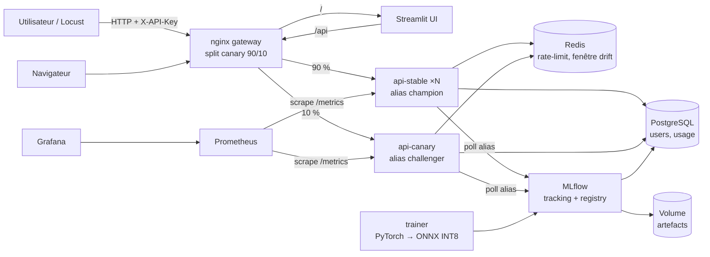

# EuroSAT MLOps — Classification d'occupation des sols en production

> Projet MLOps — M2 Data Engineering & IA  
> Binôme : **NOM Prénom** & **NOM Prénom** — Année 2026-2027

Mise en production d'un modèle de **classification d'images satellites Sentinel-2**
(jeu de données EuroSAT, 10 classes d'occupation des sols) : entraînement
tracé dans MLflow, quantization INT8, API sécurisée par clé, interface web,
détection de data drift, déploiement canary, infrastructure as code et
Kubernetes.

- **Tester le projet pas à pas : [`TESTER.md`](TESTER.md)**
- Support de soutenance : [`presentation/soutenance-mlops-eurosat.pptx`](presentation/soutenance-mlops-eurosat.pptx)

---

## 1. Architecture



| Brique | Technologie | Rôle |
|---|---|---|
| Modèle | ResNet-18 (transfer learning) → ONNX → INT8 | Classification 10 classes |
| Serving | FastAPI + onnxruntime (sans PyTorch) | Web service REST |
| Registre | MLflow (PostgreSQL + volume d'artefacts) | Versioning, alias `champion`/`challenger` |
| Sécurité | Clés d'API hachées (HMAC-SHA256), quotas Redis | Authentification, rate limit, usage par utilisateur |
| Routage | nginx `split_clients` / ingress-nginx canary | Canary deployment |
| Monitoring | Prometheus + Grafana + alertes | Latence, trafic, drift |
| Drift | PCA + test de Kolmogorov-Smirnov + PSI | Détection de data drift |
| UI | Streamlit | Interface graphique |
| Infra | Terraform (AWS EC2) + cloud-init | Provisionnement de la VM |
| CI/CD | GitHub Actions → GHCR → SSH | Déploiement continu |
| Orchestration | Kubernetes (Kustomize, HPA) | Scaling horizontal automatique |

## 2. Correspondance avec la grille d'évaluation

| Niveau | Exigence | Implémentation |
|---|---|---|
| **0** | Une commande, tout conteneurisé | `make up` (= `docker compose up -d --build`, 10 services) |
| **1** | Déploiement auto sur VM | `make deploy HOST=ubuntu@IP` ou pipeline [`cd.yml`](.github/workflows/cd.yml) sur tag `v*` |
| **1** | Token dans le header | `X-API-Key` (ou `Authorization: Bearer`) obligatoire sur `/v1/*` et `/admin/*` → [`security.py`](api/app/security.py) |
| **1** | Usage par utilisateur | Table `usage_logs`, `GET /v1/me/usage`, `GET /admin/usage`, métrique `api_user_predictions_total{user}` |
| **1** | Test de charge | Locust : [`loadtest/locustfile.py`](loadtest/locustfile.py), `make loadtest` |
| **2** | Terraform | [`infra/terraform`](infra/terraform) : EC2, SG, EIP, clé SSH, cloud-init Docker |
| **2** | Interface utilisateur | Streamlit : prédiction, usage, monitoring du drift |
| **2** | Data drift | [`drift.py`](api/app/drift.py) + jauges Prometheus + alerte + `scripts/simulate_drift.py` |
| **2** | MLflow | Tracking, Model Registry, alias, rechargement à chaud en production |
| **3** | Quantization | PTQ statique INT8 QDQ ([`quantize.py`](training/quantize.py)), comparaison FP32/INT8 loggée |
| **3** | Canary deployment | 10 % vers `challenger` (nginx et Ingress), promotion / rollback par alias |
| **3** | Scaling horizontal | `make scale N=3` (compose) ; HPA 2→10 pods (k8s) ; état partagé dans Redis |
| **3** | Kubernetes | [`k8s/`](k8s) : Deployments, Services, HPA, PDB, Ingress canary |
| **3** | Autres | Quality gate F1, rate limiting, alerting, image API sans PyTorch, CI (lint, tests, validation IaC) |

## 3. Démarrage rapide (local)

Le guide complet, avec les commandes Windows sans `make`, est dans [`TESTER.md`](TESTER.md).

```bash
python scripts/make_env.py      # secrets aléatoires -> .env (affiche la clé admin)
docker compose up -d --build    # ou : make up
docker compose logs -f trainer  # 1er modèle entraîné automatiquement (~10-20 min CPU)
```

| Service | URL |
|---|---|
| Interface | http://localhost |
| API (Swagger) | http://localhost/api/docs |
| MLflow | http://localhost:5001 |
| Grafana (admin / voir `.env`) | http://localhost:3000 |
| Prometheus | http://localhost:9090 |

### Créer un utilisateur et appeler l'API

```bash
make create-user NAME=alice QUOTA=300
# -> Clé d'API : eus_xxxxxxxx

curl -X POST http://localhost/api/v1/predict \
     -H "X-API-Key: eus_xxxxxxxx" \
     -F "file=@loadtest/images/Forest_12.jpg"
```

Exemple de réponse (format) :

```json
{
  "label": "Forest",
  "confidence": 0.97,
  "probabilities": {"AnnualCrop": 0.001, "Forest": 0.97, "...": "..."},
  "model": {"name": "eurosat-classifier", "version": "1", "alias": "champion", "variant": "int8", "track": "stable"},
  "latency_ms": 6.3
}
```

Sans clé : `401 Unauthorized`. Quota dépassé : `429 Too Many Requests`.

## 4. Cycle de vie du modèle

```bash
make train EPOCHS=15 ARCH=resnet18  # nouvelle version -> alias "challenger" (si F1 test >= 0.85)
                                    # api-canary la charge en < 30 s, 10 % du trafic
make status                         # versions, F1, alias
make promote                        # challenger -> champion (100 % du trafic)
make rollback                       # retour au champion précédent
```

Aucun redéploiement de conteneur n'est nécessaire : les services surveillent
leurs alias dans le registre MLflow et rechargent le modèle à chaud.

## 5. Production (niveaux 1 et 2)

```bash
# 1. Créer la VM
cd infra/terraform && cp terraform.tfvars.example terraform.tfvars  # adapter les IP
terraform init && terraform apply        # -> public_ip

# 2. Déployer (images GHCR)
python scripts/make_env.py .env.prod    # puis REGISTRY=ghcr.io/<owner>
make deploy HOST=ubuntu@<public_ip> TAG=v1.0.0
```

Ou en continu : pousser un tag `git tag v1.0.0 && git push --tags` déclenche
[`cd.yml`](.github/workflows/cd.yml) (build → push GHCR → déploiement SSH → smoke test).

En production, MLflow, Grafana et Prometheus ne sont **pas** exposés :
accès via tunnel SSH (`terraform output admin_tunnel`).

## 6. Test de charge

```bash
make sample-images                          # 300 images EuroSAT réelles
pip install locust
export EUROSAT_API_KEY=eus_...              # ou EUROSAT_API_KEYS=k1,k2,k3 (usage multi-utilisateurs)
make loadtest API_URL=http://<public_ip>/api USERS=100 DURATION=5m
```

Rapports CSV/HTML dans `loadtest/results/`. Pendant le test, le tableau de
bord Grafana montre la répartition stable/canary, la latence p50/p95 et le
nombre de requêtes par utilisateur.

## 7. Démonstration du data drift

```bash
make drift-demo KEY=eus_... P=none     # contrôle : pas de drift attendu
make drift-demo KEY=eus_... P=clouds   # couverture nuageuse simulée -> drift
```

## 8. Kubernetes (niveau 3)

```bash
# cluster avec ingress-nginx et metrics-server (ex. kind, k3s, EKS)
sed -i 's/OWNER/<owner>/' k8s/*.yaml
make k8s-apply
kubectl -n eurosat get hpa -w             # observer l'autoscaling pendant un test de charge
```

## 9. Arborescence

```
api/            service d'inférence FastAPI (auth, drift, métriques, registre)
training/       entraînement PyTorch, export ONNX, quantization, promotion
ui/             interface Streamlit
gateway/        nginx (reverse proxy + canary)
monitoring/     Prometheus (règles d'alerte) + Grafana (dashboard provisionné)
loadtest/       scénario Locust
infra/terraform VM AWS
k8s/            manifestes Kubernetes
scripts/        déploiement, génération de secrets, démo drift
tests/          tests unitaires et d'intégration (pytest)
presentation/   support de soutenance (.pptx)
```

## 10. Tests

```bash
pip install -r api/requirements.txt pytest httpx onnx
make test
```

Les tests d'intégration utilisent un mini-modèle ONNX généré à la volée qui
respecte le même contrat que le vrai modèle : ils couvrent l'authentification,
les droits admin, le rate limiting, la prédiction unitaire et par lot, le
suivi de l'usage et le rapport de drift, sans PyTorch ni base PostgreSQL.
